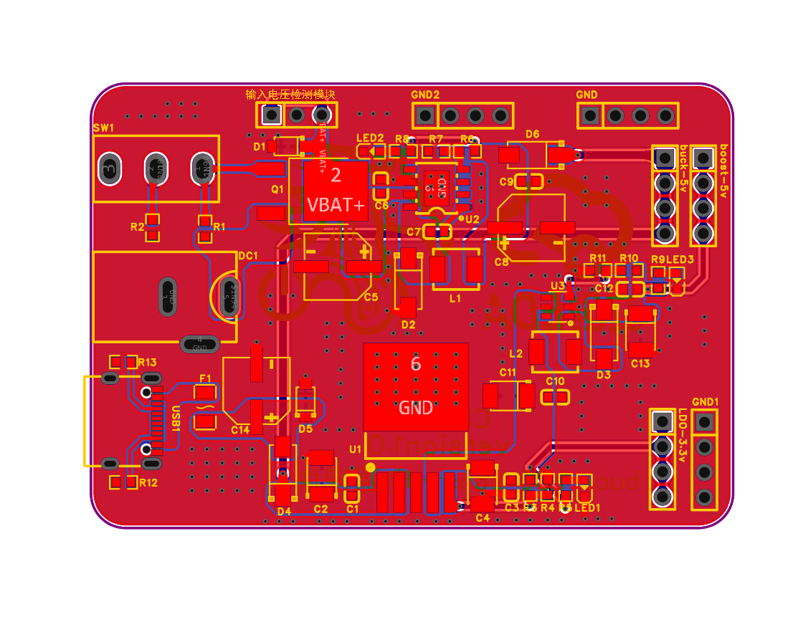
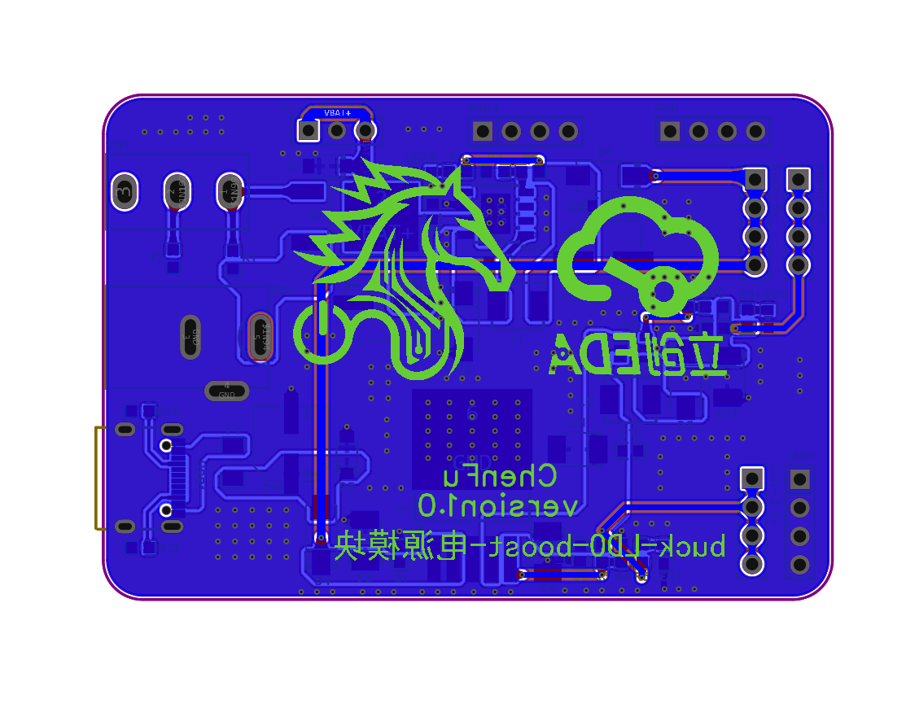

# Buck-Boost-LDO 电源模块（双输入自动切换）

一块集成 **Buck 降压 + LDO 线性稳压 + Boost 升压** 与 **双电源二极管或流（OR-ing）自动切换** 的电源教学/供板模块。支持 DC 12.6V 与 Type-C 5V 两路输入自动切换、互不倒灌，输出 5V / 3.3V / 5V（Boost）三路电源给后级项目供电。

原理图与 PCB 独立设计、嘉立创打样、手工焊接，**静态电压与 Type-C 供电路径带载实测通过**——Boost 输出直接给 STM32F103 项目供电，运行稳定。



---

## 功能特性

- **双输入**：DC 12.6V（P-MOS 高侧电子开关）/ Type-C 5V（自恢复保险 + 5.6V 钳位）
- **自动切换、防倒灌**：两路 5V 经肖特基二极管或流（D4/D6，SS54），电压高的一路导通，另一路反偏截止
- **三级电源变换**：
  - DC 12.6V → **Buck 5V**（TPS5430，3A，500kHz）
  - 5V → **LDO 3.3V**（SPX29302，800mA）
  - 3.3V → **Boost 5V**（MT3608，1.2MHz）给后级项目供电
- **保护**：USB 路 0.5A 自恢复保险丝、5.6V/16V 稳压管浪涌钳位、P-MOS 电子开关低损耗通断
- **可观测**：三路电源指示灯、2.54mm 排针引出全部电源轨、3P 检测插针

## 电源树

```
DC 12.6V ─ Q1(P-MOS,SW1) ─ VBAT+ ─ TPS5430 Buck ─ 4.99V ─ D6(SS54) ─┐
                                                                       │
Type-C 5V ─ F1(0.5A) ─ D5(5.6V钳位) ─ Input_5V ─ D4(SS54) ───────────┴─ VCC5V
                                                                          │
                                          ┌───────────────────────────────┤
                          SPX29302 LDO(5V→3.3V) ─ 3.26V  ◄── 排针 LDO-3.3v
                                          │
                          MT3608 Boost(3.3V→5V) ─ 5.01V(带载) ◄── 排针 boost-5v
                                                                        ▲
                                                            STM32F103 项目实际负载
```

## 关键器件

| 位号 | 型号 | 功能 |
|:---|:---|:---|
| U2 | TPS5430DDAR（TI） | 5.5~36V 输入 / 3A 非同步 Buck，500kHz |
| U1 | SPX29302T5 | 800mA 低压差可调 LDO（Vref 1.24V） |
| U3 | MT3608 | 1.2MHz / 2A Boost（Vref 0.6V） |
| Q1 | HY19P03D | P-MOS（−30V/−90A）高侧电子开关，SW1 控栅极 |
| D4 / D6 | SS54 ×2 | 肖特基 40V/5A，二极管或流 + 防倒灌 |
| D1 / D5 | BZT52C16 / BZT52C5V6 | 16V / 5.6V 浪涌钳位稳压管 |
| L1 / L2 | 22µH / 4.7µH | Buck 储能 / Boost 储能 |
| F1 | SMD1206-050-16 | 0.5A 自恢复保险丝 |

输出电压由反馈电阻精确设定（实测与理论高度吻合）：

- Buck：Vout = 1.221×(1+6.8k/2.2k) = **4.995V** → 实测 **4.99V**
- LDO：Vout = 1.24×(1+3.3k/2k) = **3.286V** → 实测 **3.26V**
- Boost：Vout = 0.6×(1+110k/15k) = **5.00V** → 空载 5.04~5.08V / 带载 **5.01V**

---

## 实物与设计图

| PCB 顶层 | PCB 底层 |
|:---:|:---:|
|  |  |

完整原理图：[Hardware/Schematic/SCH_buck-boost-ldo.pdf](Hardware/Schematic/SCH_buck-boost-ldo.pdf)

## 实测数据

仪表：胜利 9205C 数字万用表（DC 电压档）。完整数据见 [Verification/测试记录.md](Verification/测试记录.md)。

**静态电压（两种供电方式全覆盖）：**

| 测试点 | DC 12.6V 供电 | Type-C 5V 供电 |
|:---|:---|:---|
| VBAT+（Q1 后） | 12.45V | 0V（Q1 关断） |
| Buck 输出（D6 阳极） | 4.99V | 0V（无输入不工作） |
| VCC5V 公共母线（D6/D4 阴极） | 4.78V | 4.90~4.98V |
| LDO 3.3V | 3.26V | 3.26V |
| Boost 5V（空载） | 5.08V | 5.04V |

**防倒灌实测（二极管或流的核心验证）：**

| 供电方式 | D4（USB 路） | D6（Buck 路） |
|:---|:---|:---|
| DC 12.6V | 阳 0V / 阴 4.78V，**反偏截止** | 阳 4.99V / 阴 4.78V，**导通** |
| Type-C 5V | **导通**（母线 4.9~4.98V） | 阳 0V / 阴 4.98V，**反偏截止** |

Type-C 供电时 D6 阳极 0V、阴极 4.98V，实测证明 5V 不会经 Buck 倒灌回 DC 侧。

**带载实测：** Boost 5V 排针直挂 **STM32F103 开发板 + MQ-2 传感器模块 + 风扇** 负载，Boost 输出 5.01V（相对空载仅跌落 0.03V），LDO 3.26V 零跌落，后级项目全程运行正常。

---

## 目录结构

```
├── README.md
├── Hardware/
│   ├── EasyEDA-Pro/     # 嘉立创EDA专业版工程文件（.epro2，可直接打开编辑）
│   ├── Gerber/          # 制板文件（Gerber 压缩包，可直接下单）
│   ├── Schematic/       # 原理图 PDF
│   ├── Images/          # PCB 与原理图 PNG
│   └── BOM/             # 物料清单（含嘉立创下单 BOM）
├── Docs/                # PCB 焊接指南
└── Verification/        # 测试记录（实测数据与分析）
```

## 设计工具

- 原理图 / PCB：嘉立创 EDA 专业版（工程文件已包含在仓库内，可直接复现打样）
- 制板：嘉立创 PCB 打样
- 焊接：贴片工艺手工焊接

---

## 声明

- 本项目为个人电源拓扑学习作品，仅供学习交流使用。
- 二极管或流方案存在肖特基压降（实测约 0.21V@轻载），大电流应用可升级为理想二极管（控制器 + MOS）方案。
